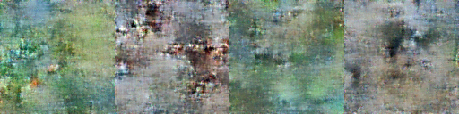
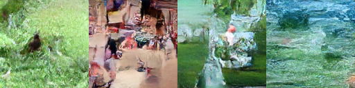

# Text-to-Image Diffusion U-Net (v2) with Token-Level Cross-Attention

[](https://huggingface.co/geeteshcodes/t2i-coco-128-clipL)
[](https://www.kaggle.com/datasets/geeteshsin/t2i-code)
[](https://www.kaggle.com/datasets/awsaf49/coco-2017-dataset)
[](https://www.python.org/downloads/)
[](https://tensorflow.org)
[](LICENSE)

An end-to-end, high-efficiency Text-to-Image (T2I) diffusion model built in TensorFlow / Keras. Features a custom 4-level U-Net architecture conditioned on token-level text embeddings via multi-head cross-attention and FiLM (Feature-wise Linear Modulation), optimized with Min-SNR-$\gamma$ loss weighting, EMA weights tracking, Classifier-Free Guidance (CFG), and fast DDIM sampling.

Designed from the ground up for high training efficiency under constrained compute quotas (e.g., Kaggle TPU/GPU sessions) with fault-tolerant checkpointing and seamless Hugging Face Hub synchronization.

---

## 🔗 Project Links

- **Hugging Face Model Repository**: [geeteshcodes/t2i-coco-128-clipL](https://huggingface.co/geeteshcodes/t2i-coco-128-clipL) *(Trained weights `t2i_weights_v2.h5`, checkpoint history, and precomputed embeddings)*
- **Kaggle Code Dataset**: [geeteshsin/t2i-code](https://www.kaggle.com/datasets/geeteshsin/t2i-code)
- **Training Dataset (MS-COCO 2017)**: [awsaf49/coco-2017-dataset](https://www.kaggle.com/datasets/awsaf49/coco-2017-dataset) *(also supports Flickr30k & Flickr8k)*

---

## 🎨 Sample Outputs During Training

As training progresses, the model learns coarse composition, shapes, textures, and fine-grained prompt alignment:

| Step 1,780 | Step 9,880 | Step 18,820 |
| :---: | :---: | :---: |
|  |  |  |

| Step 30,180 | Step 45,520 | Step 86,660 |
| :---: | :---: | :---: |
|  |  |  |

*Preview grids display test prompts across different Classifier-Free Guidance (CFG) scales.*

---

## 🏗️ Architecture & Technical Highlights

```
Text Prompt ──> SentenceTransformer (MiniLM / CLIP-L) ──> Token Embeddings + Mask + Register Token
                                                                     │
                                                                     ▼
Latent/Noisy Image x_t (128x128x3) ──> [Encoders 128 -> 64 -> 32 -> 16] ──> [Bottleneck 16x16] ──> [Decoders 16 -> 32 -> 64 -> 128] ──> Pred Noise
                                            │                     │                  │                      │
Timestep t ──> Sinusoidal MLP ──────────────┴────── FiLM ─────────┴──── Self/Cross ──┴─────────── FiLM ─────┘
                                                                       Attention
```

1. **Token-Level Cross-Attention**:
   - Instead of a single pooled sentence embedding, every token from the text encoder acts as a key/value pair in multi-head cross-attention layers at $32 \times 32$ and $16 \times 16$ resolutions.
   - Learnable positional embeddings and a dedicated register token retain unconditional global context.
2. **Spatial Self-Attention**:
   - Zero-initialized residual self-attention at the $16 \times 16$ bottleneck and decoder levels captures long-range spatial dependencies.
3. **FiLM Residual Conditioning**:
   - Feature-wise Linear Modulation (`h = h * (1 + scale) + shift`) injects fused sinusoidal timestep representations and pooled text embeddings directly into every convolution block.
4. **Squeeze-and-Excitation (SE) Channels**:
   - Global channel attention after convolution blocks dynamically recalibrates feature maps.
5. **Classifier-Free Guidance (CFG)**:
   - Trained with 15% text dropout (replacing text embeddings with null vectors).
   - Allows fine-tuning prompt fidelity versus sample diversity at inference time via guidance scale $w$ (recommended: $3.0 - 7.5$):
     $$\hat{\epsilon} = \epsilon_\text{uncond} + w \cdot (\epsilon_\text{cond} - \epsilon_\text{uncond})$$
6. **Min-SNR-$\gamma$ Loss Weighting**:
   - Stabilizes diffusion training by dynamically clamping loss weights based on the signal-to-noise ratio:
     $$w_t = \min\left(\text{SNR}(t), \gamma\right) / \text{SNR}(t), \quad \gamma = 5.0$$
7. **Exponential Moving Average (EMA)**:
   - Maintains shadow EMA weights ($\beta = 0.999$) for smoother, artifact-free image generation.
8. **Fast DDIM Reverse Sampling**:
   - Deterministic or stochastic DDIM sampler generates high-fidelity images in 20–50 steps rather than 1,000 steps.

---

## 📁 Repository Structure

```
.
├── architecture.py        # U-Net v2 model: FiLM ResBlocks, Multi-Head Self & Cross Attention
├── diffusion.py           # Gaussian diffusion engine: Cosine beta schedule, DDPM q_sample & DDIM CFG sampler
├── text_encoder.py        # Token-level sentence embedding extractor with padding & mask packing
├── dataset.py             # Universal dataset parser (MS-COCO 2017 JSON, Flickr30k, Flickr8k, CSV)
├── train_kaggle.py        # Distributed TPU / Multi-GPU training script with quota & HF Hub auto-sync
├── test_generate.py       # Inference CLI with auto-download of Hugging Face pretrained weights
├── stable-diff.ipynb      # Interactive Kaggle / Colab training & sampling notebook
├── requirements.txt       # Project Python dependencies
├── samples/               # Sample generated image previews across training steps
├── LICENSE                # MIT License
└── README.md
```

---

## 🚀 Quickstart & Inference

### 1. Installation

Clone this repository and install the dependencies:

```bash
git clone https://github.com/geeteshcodes/stable_diff.git
cd stable_diff

pip install -r requirements.txt
```

> **Note**: This codebase uses Keras 2 (`tf-keras`). If you are running TensorFlow 2.16+, set `export TF_USE_LEGACY_KERAS=1` before execution.

### 2. Generate Images with Pretrained Weights

You can immediately sample images without manually downloading weights — `test_generate.py` will automatically fetch `t2i_weights_v2.h5` from the [Hugging Face Hub repository](https://huggingface.co/geeteshcodes/t2i-coco-128-clipL):

```bash
python test_generate.py \
    --prompts "a dog running through green grass" "a child playing outside with a ball" \
    --scales 3.0 5.0 7.5 \
    --steps 50 \
    --out generated_grid.png
```

### 3. Python API Usage

```python
import tensorflow as tf
from architecture import TextToImageUNet
from diffusion import GaussianDiffusion
from text_encoder import TextEncoder

# 1. Initialize models
model = TextToImageUNet(base_filters=32, text_dim=384)
dummy = [
    tf.zeros([1, 128, 128, 3]),
    tf.zeros([1], tf.int32),
    tf.zeros([1, 24, 385]),
]
model(dummy, training=False)
model.load_weights("t2i_weights_v2.h5")

# 2. Encode text prompt
encoder = TextEncoder()
prompts = ["a brown dog jumping into water", "a girl in a pink dress smiling"]
embeddings = tf.convert_to_tensor(encoder.encode(prompts), tf.float32)

# 3. Sample with DDIM and Classifier-Free Guidance
diffusion = GaussianDiffusion(timesteps=1000)
images = diffusion.sample_text_to_image(
    model=model,
    text_emb=embeddings,
    shape=[len(prompts), 128, 128, 3],
    guidance_scale=5.0,
    ddim_steps=50,
)

# Convert to uint8 RGB
uint8_images = ((images.numpy() + 1.0) * 127.5).clip(0, 255).astype("uint8")
```

---

## ⚡ Training on Kaggle (TPU / GPU)

The training pipeline in `train_kaggle.py` was built specifically for Kaggle's weekly compute quotas:
- **Auto-detection**: Automatically configures `TPUStrategy` on TPU VMs, `MirroredStrategy` on multi-GPU (e.g. 2x T4), or standard GPU/CPU.
- **Session-Limit Aware**: Kaggle sessions automatically stop around 9h (TPU) or 12h (GPU). The script monitors elapsed time, safely flushes EMA weights, snapshots checkpoints, and exits before the session is forcibly killed.
- **Hugging Face Hub Persistence**: Seamlessly synchronizes checkpoints and weights to a Hugging Face model repository so multi-session runs resume right where they left off.

### Kaggle Setup

1. Create a Kaggle notebook and add:
   - **Code Dataset**: [geeteshsin/t2i-code](https://www.kaggle.com/datasets/geeteshsin/t2i-code)
   - **Training Dataset**: [awsaf49/coco-2017-dataset](https://www.kaggle.com/datasets/awsaf49/coco-2017-dataset) (or Flickr30k)
2. Add your Hugging Face API token in **Add-ons -> Secrets** with the name `HF_TOKEN`.
3. Set your target Hugging Face repository and launch:

```bash
export HF_REPO="geeteshcodes/t2i-coco-128-clipL"
export T2I_BASE_FILTERS=32
export T2I_TARGET_PASSES=100

python train_kaggle.py
```

### Supported Dataset Formats

`dataset.py` automatically detects and loads:
- **MS-COCO 2017**: Reads standard `captions_train2017.json` and maps to `train2017/` images.
- **Flickr30k**: Pipe-separated `image_name|caption_id|caption`.
- **Flickr8k**: Tab-separated `image#0\tcaption` or CSV format `image,caption`.
- **Custom Datasets**: Set `T2I_CAPTIONS=/path/to/annotations` and `T2I_IMAGES=/path/to/images`.

---

## 📊 Training Hyperparameters

| Parameter | Value | Description |
| :--- | :--- | :--- |
| **Image Resolution** | $128 \times 128 \times 3$ | Center-cropped and resized RGB images |
| **Diffusion Timesteps** | $1000$ | Cosine beta schedule ($\alpha$-cumprod formulation) |
| **Base Channels ($f$)** | $32$ (or $48$) | Multi-resolution channel scaling ($f, 2f, 4f, 8f$) |
| **Text Dimension** | $384$ | `all-MiniLM-L6-v2` token-level embeddings |
| **Token Sequence Length** | $24$ | Padded/truncated token length with attention masks |
| **Text Dropout (CFG)** | $0.15$ | Drop probability to unconditional null prompt |
| **Min-SNR-$\gamma$** | $5.0$ | Dynamic loss weighting parameter |
| **EMA Decay** | $0.999$ | Shadow weight smoothing rate |
| **Learning Rate** | $1\times 10^{-5} \to 2.8\times 10^{-4}$ | Warmup ($40\text{k}$ samples) + Cosine Decay |
| **Gradient Clipping** | $1.0$ | Global norm clipping |

---

## 📜 License

This project is open-source and released under the [MIT License](LICENSE).
